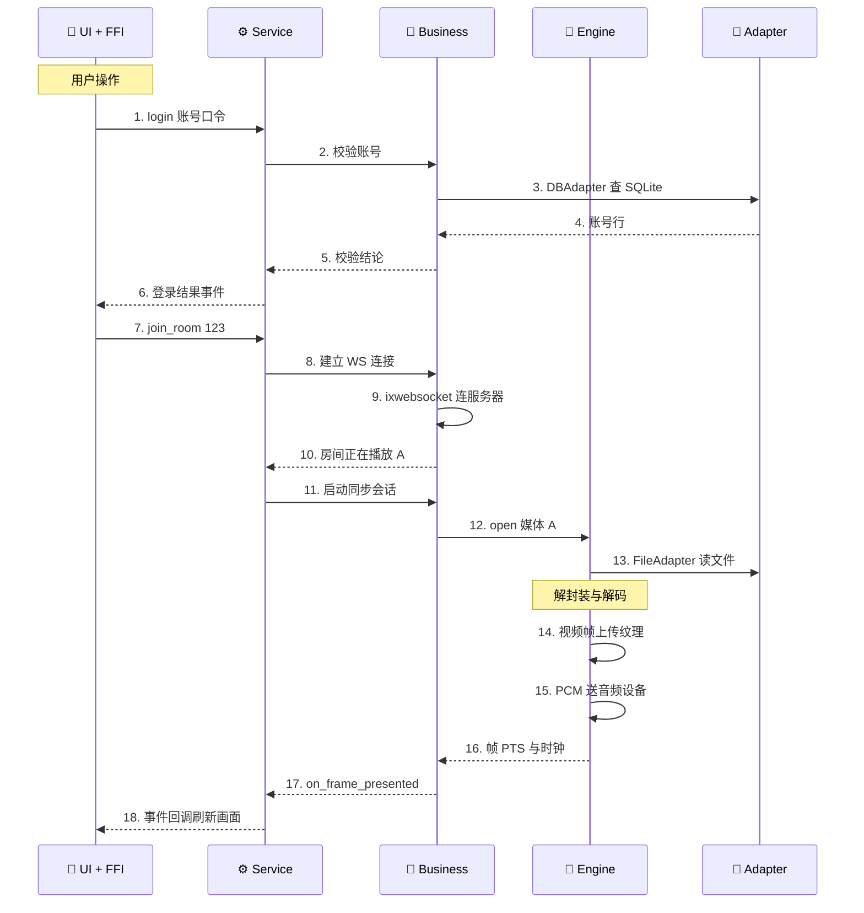
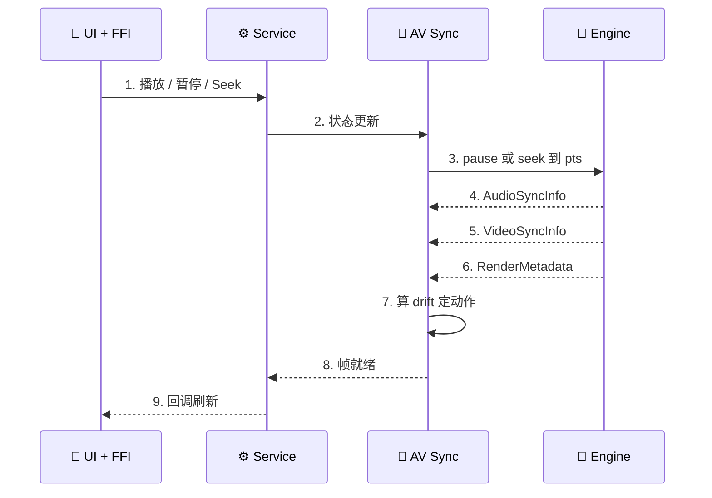
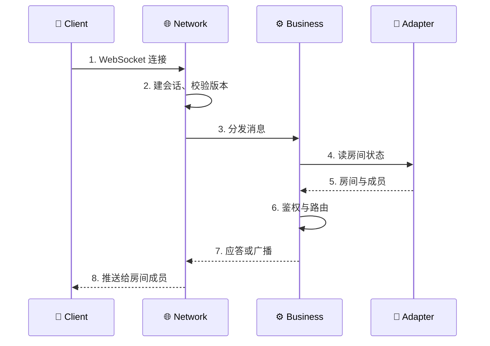
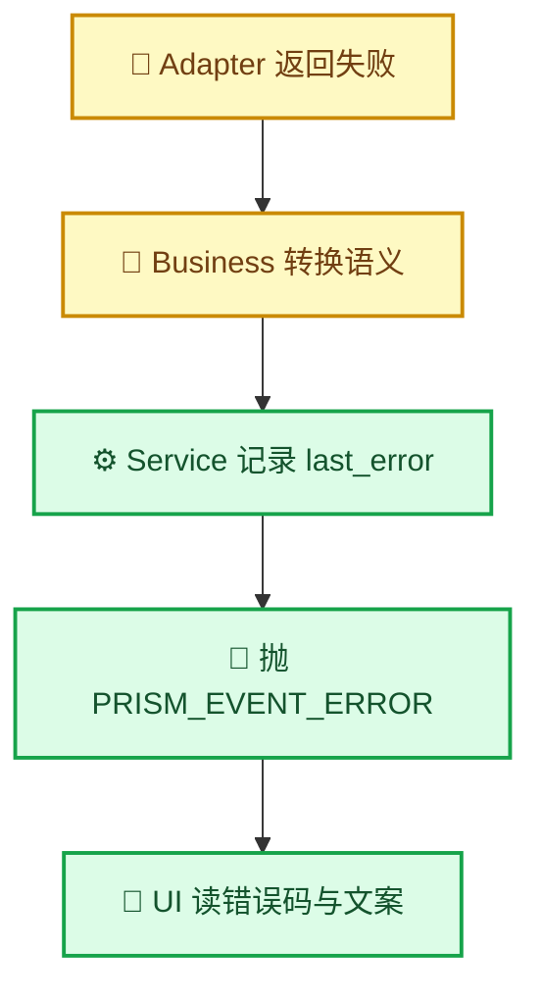

# PrismPlayer 数据流文档

_一次播放请求在六层之间怎么流动 · 基线 `75ba727` · 2026-11-17_

---

**本文档只画「数据怎么走」。** 每个环节跑不跑得通、代码在哪一行，见 `项目计划书.md` § 当前状态；层与层的边界见 `项目框架.md`；接口签名见 `API接口文档.md`；术语以 `GLOSSARY.md` 为准。

记号：✅ 真实链路 / 🟡 半通 / ⛔ 断开。

---

## 📍 整体数据流向

登录、进房间、开播三段串成一条主链路。

**这条链路上每一段是真的吗**：

| 步骤 | 环节 | 状态 | 依据 |
|---|---|---|---|
| **1–6** | 登录 → 查库 → 回事件 | ⛔ 断开 | `SQLiteDBAdapter` 的 CRUD 是真的（608 行、9 个用例），但**没有任何代码在登录路径上调用它**；真正的登录要走 `client-network`，而它 `src/` 无源文件、目标不生成 |
| 7–10 | 进房间与 WS 信令 | ⛔ 断开 | `ISignalingClient.h` 只有接口；`internal/NetImpl.h` 0 字节 |
| **11–12** | 启动同步会话并下发 open | 🟡 半通 | `CommandDispatcher.cpp` 130 行会把命令发出去，但对端 Engine 是桩 |
| 13 | Adapter 读文件 | ✅ 组件级可用 | `WinFileAdapter.cpp` 187 行支持打开/读/seek/大小查询；**但链路上没有调用方** |
| 14–15 | 解码 + 渲染 + 音频输出 | ⛔ 断开 | `client/engine/src/` 无任何 FFmpeg 源文件；WASAPI 与 Vulkan 实现都是桩 |
| **16–18** | 帧状态回传与 UI 刷新 | 🟡 半通 | `EngineObserver.cpp` 58 行是真的，但收不到真实帧；Dart 侧 `ffi_bridge.dart` 已生成 32 个 API 绑定，但仍无人 import/调用 |

> ⚠️ **真正跑得通的只有中段**：命令分发、状态机、漂移计算与文件读写这四块各自可用，但它们还没有被接成一条链 —— Adapter 能读写文件，却没有任何上层代码调用它。这正是「组件已落地、链路未打通」的具体含义。

---

## 🔄 播放控制数据流

播放、暂停、Seek 都是下行命令 + 上行状态的两段式。

关键点：

| 环节 | 说明 |
|---|---|
| **命令是同步的** | 第 2–3 步在调用线程上直接完成状态迁移，不等 Engine 回执；Engine 返回 `false` 时命令整体失败并写 `last_error` |
| 状态回传是异步的 | 第 4–6 步由 Engine 自己的线程抛出，Service 收敛到用户回调；**用户回调里不得再调 `prism_player_*`**（同锁自死锁） |
| 判定在 AV Sync 内 | `drift = video_pts - audio_pts`，超 30 ms → `WAIT`，低于 -50 ms → `DROP`，否则 `RENDER` |

> 📌 现状：`Engine` 的三个返回结构体（`AudioSyncInfo` / `VideoSyncInfo` / `RenderMetadata`）返回值全是零值默认，所以第 7 步算出来的 `drift` 恒为 0，永远走 `RENDER`。链路结构正确、数据是假的。

---

## 🌐 Server 端数据流

服务端只转发控制信令，不碰音视频数据。

| 环节 | 实现位置 | 现状 |
|---|---|---|
| **1–2** | `server/network/src/{IxWebSocketServer,SessionManager}.cpp` | 🟡 真实实现（216 + 77 行），未联调 |
| 3、6–7 | `server/business/src/{AuthService,RoomManager,MessageRouter}.cpp` | 🟡 真实实现（42 + 54 + 25 行），规则未覆盖全部 spec |
| 4–5 | `server/adapter/src/InMemoryDbAdapter.cpp` | 🟡 进程内存储，重启即丢；MySQL 客户端不在 manifest 里 |

表结构与查询要求见 `项目计划书.md` § 数据库设计（唯一真源，含 E-R 图）。

---

## ⚠️ 回调与错误的传播

错误从下往上传的顺序固定，不在中间层做「静默吞掉」。

三条约定：

1. **Adapter 不抛异常** —— 失败用 `bool` 或 `std::nullopt` 表达（`JSONConfigAdapter` 明确「不抛异常」），这样上层不需要 try/catch 跨 DLL 边界；
2. **Service 是唯一写错误状态的地方** —— `prism_player_get_last_error()` 返回最后一次失败的原因，成功后不清空（便于排查时序问题）；
3. **事件与返回值不重复报错** —— 同步失败用返回值（`PrismResult`），异步失败用 `PRISM_EVENT_ERROR`，同一次失败只走一条路。

> 📌 现状：`IServiceNetwork.h` 背后的默认桩把所有网络操作直接返回失败，所以 Service 的登录/进房间路径今天必然走错误分支 —— 这是**设计上的降级**（没有网络模块也能编译运行、不崩溃），不是缺陷。
