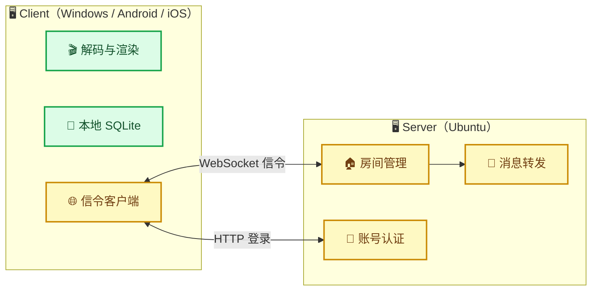
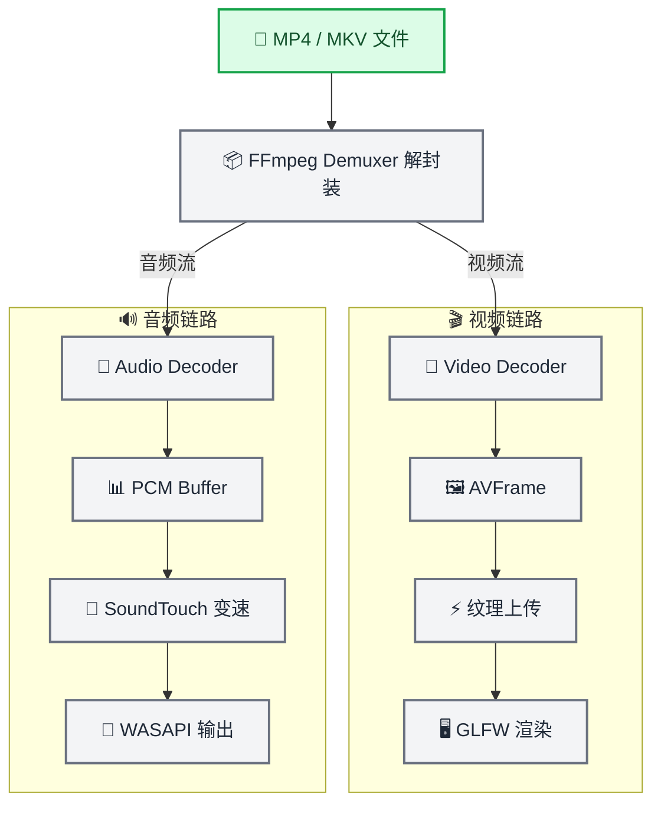
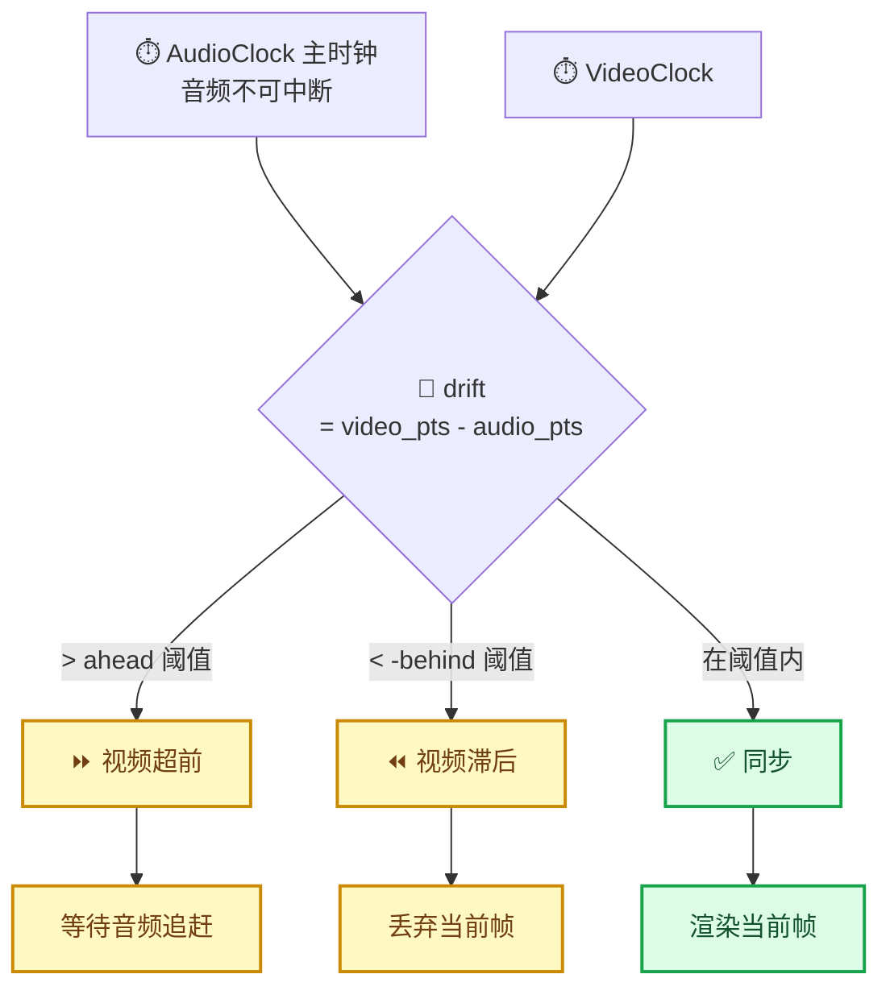
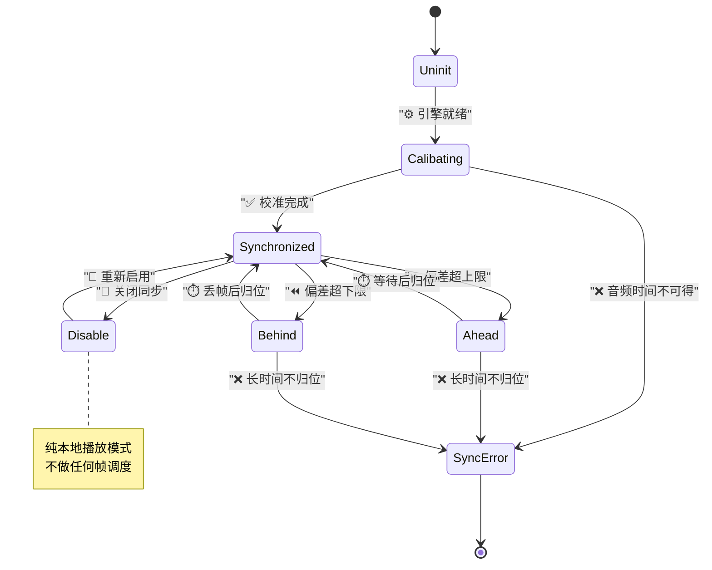
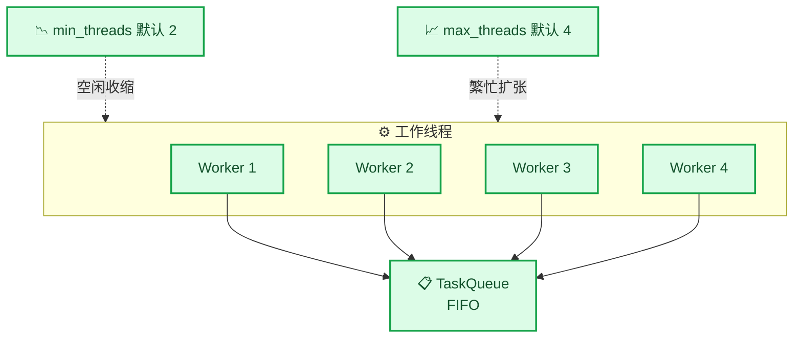

# PrismPlayer 设计文档

_选型理由与设计意图 · 基线 `75ba727` · 2026-11-17_

---

**本文档只记录「为什么这么设计、否决了什么」。** 它不描述现状 —— 实现进度与行数见 `项目计划书.md` § 当前状态；目录与边界见 `项目框架.md`；接口签名见 `API接口文档.md`；端到端时序见 `数据流.md`；表结构见 `项目计划书.md` § 数据库设计。

本文档在 2026-06-01 创建、2026-06-10 被 `aa3e210` 整体删除 321 行（同一提交把 C API 部分搬进了 `API接口文档.md`），后按 `01ac42a` 恢复，因为选型对比、解码管线、Vendor 设计、设计模式、安全设计这五类内容在其他文档里没有等价物。

各节的选型理由是 ADR 的素材来源（`docs/adr/`）。状态标记只有四个词：✅ 已落地 / 🟡 仅骨架 / 📐 仅设计 / ⛔ 已废弃。

---

## 🎯 设计目标

PrismPlayer 是跨平台音视频播放器，支持本地播放与联机同步播放。

| 目标 | 可验收的判据 |
|---|---|
| **高性能解码与渲染** | 1080p60 播放不掉帧；解码与渲染分线程，GPU 上传不阻塞解封装 |
| 多客户端实时同步 | 同一房间内客户端画面偏差 < 100 ms（AV Sync 的两个阈值 30 / 50 ms 留了余量） |
| 跨平台 | Windows 先落地；Android / iOS 只换 Engine 与 Adapter 的实现，不改上层 |
| 模块化与二次开发 | 对外只有 C ABI 一个出口（32 个 `prism_player_*`），内部层可替换 |

> 📌 平台现状：`ui/` 是 Flutter 全平台脚手架但仍是官方计数器模板；`client/` 只在 Windows 上构建过；Android / iOS 无任何构建记录。

---

## 📚 总体架构决策

### 为什么是六层

| 要素 | 决策 | 理由 |
|---|---|---|
| **分层数** | 6 层（UI / FFI / Service / Business / Engine / Adapter） | 每层的变更频率差异大：UI 改版不影响解码，解码换实现不影响 UI。层数再少会把「平台差异」和「业务规则」混在一起 |
| 客户端/服务端分离 | Client + Server 两个独立构建 | 联机播放需要中心化的房间与消息路由；服务端目标平台是 Ubuntu，与客户端依赖树完全不同 |
| 动态库 vs 静态库 | Engine / Service 用共享库，Business / Adapter 用静态库 | 对外只有两个符号出口（C ABI 与引擎接口）；其余层静态链接，导出面不会失控 |
| 客户端不嵌服务端 | 两个 `add_subdirectory` 平级，Server 不链接 `client/` | 跨侧一致性靠夹具验证而非共享代码（spec #117 决策 25 / 42），避免为了复用而把播放器依赖拖进服务端 |

> 💡 **Engine/Service 用动态库的真实动机是 FFI**，不是热插拔：`ui/lib/ffi/ffi_bridge.dart` 由 ffigen 从 `Player.h` 生成；Flutter 运行期用 `DynamicLibrary.open` 加载 `build/client/service/libclient-service.dll` 后构造 `NativeLibrary`（当前尚无调用方）。这也是为什么 Service 必须是 C ABI 而不是 C++ 类。

### 为什么客户端与服务端要分开部署



- **音视频数据不过服务端**：服务端只转发控制信令（谁在放、放到哪一秒、谁进了房间），媒体本体在客户端本地或直传；
- **账号与房间状态在服务端**：这是需要全局一致的部分，也是为什么服务端要 MySQL；
- **协议**：信令走 WebSocket（低延迟、双向），登录与房间列表走 HTTP（无状态、易重试）。

---

## 🔧 Engine 层选型

### 为什么是 WASAPI 共享模式

| 方案 | 延迟 | CPU | 独占性 | 选定 |
|---|---|---|---|---|
| WASAPI Exclusive | 极低 | 低 | 独占设备 | ❌ |
| **WASAPI Shared** | 低 | 低 | 与系统混音 | ✅ |
| DirectSound | 高 | 低 | 共享 | ❌ |
| WaveOut | 极高 | 低 | 共享 | ❌ |

**理由**：共享模式在延迟与兼容性之间取平衡 —— 用户播放时仍能听到系统通知音，不需要为了听歌关掉一切。独占模式的低延迟对本项目没有价值（不是专业音频工作站），却会让用户无法同时听别的应用。

**跨平台扩展路径**：`AudioEngineWasapiShared`（Windows）→ `AudioEngineAAudio`（Android）→ `AudioEngineAudioUnit`（iOS/macOS），由工厂按平台选择。工厂抽象成 `virtual std::unique_ptr<AudioEngine> create_audio_engine() = 0` 的目的，是让 Service 只依赖抽象指针：换平台只换工厂实现，`Service` 一行不改。

### 为什么是 Vulkan

| 方案 | 性能 | 跨平台 | 学习曲线 | 选定 |
|---|---|---|---|---|
| **Vulkan** | 极高 | ✅ Win / Android / Linux | 高 | ✅ |
| DirectX 12 | 极高 | ❌ 仅 Windows | 中 | ❌ |
| OpenGL | 中 | ✅ | 低 | ❌ |
| Metal | 极高 | ❌ 仅 Apple | 中 | ❌ |

**理由**：

- Vulkan 是唯一同时覆盖 Windows、Android、Linux 的现代 GPU API —— 三个平台一套代码，符合「跨平台靠换实现而非换架构」的目标；
- 显式资源管理（`VkImage` → 纹理）让「帧到屏幕」的路径可预测，这是低延迟渲染的前提；OpenGL 的驱动侧隐式状态在这种帧率敏感场景下难以定位抖动来源。

### 解码管线

数据从文件到扬声器/屏幕是两条并行链，共用一次解封装。



两条链路的关键设计约束：

| 约束 | 原因 |
|---|---|
| **音频链路是主时钟** | 音频设备按固定采样率消费 PCM，不可中断也不能快进；视频可以等（WAIT）或跳帧（DROP） |
| **解封装与解码分线程** | 解封装受 I/O 影响，解码受 CPU 影响，串在一起会让 I/O 抖动直接变成播放卡顿 |
| 变速处理在解码之后 | SoundTouch 消费 PCM 而非压缩流，这样倍速播放不需要重新解码 |

> ⚠️ 这条管线上除 `FileAdapter` 外**每一环在磁盘上都还没有源文件**：`client/engine/src/` 下没有任何 FFmpeg 相关代码。

---

## 🔄 Service 门面设计

### opaque handle 模式

对外只暴露不透明句柄与 C 函数，隐藏 `PlayerImpl`：

```c
typedef struct PrismPlayer PrismPlayer;   /* 结构体定义不导出 */

PrismPlayer* prism_player_create(const PrismConfig* config);
void         prism_player_destroy(PrismPlayer* player);
```

| 决策 | 理由 |
|---|---|
| **为什么是 C ABI** | Flutter 的 `dart:ffi` 只能调 C 符号；C++ 类布局不稳定，跨编译器/跨版本会崩 |
| 为什么句柄包住一切 | 状态（播放器实例、回调、线程）全在 `PlayerImpl` 里，Dart 侧只持有一个指针，不需要理解对象生命周期 |
| 为什么用 `PRISM_API` 宏 | 导出宏集中在 `client/common/API.h`，共享库的导入/导出修饰随平台切换，调用方不需要 `__declspec` |

32 个 API 的完整签名与语义见 `API接口文档.md` § Service C API，本文档不复制。

### 事件回调的线程模型

**引擎回调 → Service 线程 → 用户回调**的单向流：Engine 在自己的线程上抛事件，Service 收敛到调用方注册的回调，用户回调里**不得**再调 API（会在同一把锁上自死锁）。事件枚举的 10 个值见 `API接口文档.md` § 事件回调。

设计取舍：回调不做队列化（不额外起分发线程），因为播放器的事件频率低（加载/完成/错误），多一个线程只会增加时序不确定性；代价是用户回调必须短。

---

## ⚡ Business 层设计

### AV Sync：以音频为主时钟的漂移判定



三个阈值的默认值（`client/business/av_sync/include/SyncTypes.h`）：

| 参数 | 默认 | 作用 |
|---|---|---|
| **`ahead_threshold_ms`** | 30 | 视频超前超过它就 WAIT，避免抢跑 |
| `behind_threshold_ms` | 50 | 视频滞后超过它就 DROP，避免累积延迟 |
| `calibrate_duration_ms` | 500 | 起始 500 ms 只校准不判定，避免开头就丢帧 |

> 💡 **为什么滞后阈值（50）比超前阈值（30）宽松**：丢帧是用户可见的，等待是不可见的。宁可让视频多等 10 ms，也不要因为阈值太紧而频繁丢帧。

### AV Sync：七态状态机

状态定义在 `client/business/av_sync/include/SyncTypes.h`（`enum class SyncState`），`SyncAction` 是它的输出。



七个状态的含义：`UNINIT` 未初始化、`CALIBATING` 校准中（初始缓冲）、`SYNCHRONIZED` 已同步、`AHEAD` 音频时间超前、`BEHIND` 音频时间滞后、`DISABLE` 未启用同步、`SYNC_ERROR` 错误。

> 📌 `practice/AudioDecoder.h` 里另有一套同名的 `sync_state`（7 态、含 `ERROR`），是 **2026 年 6 月的早期设计稿**，未被 git 跟踪、不在构建中；正版以 `SyncTypes.h` 为准（`SYNC_ERROR` 而非 `ERROR`）。两处不要混。

### Network：为什么选异步 I/O

| 方案 | 线程模型 | 适用 | 选定 |
|---|---|---|---|
| **ASIO 异步 I/O** | 单线程 EventLoop + 回调 | 高并发连接、资源敏感 | ✅ 设计上 |
| 同步 + 线程池 | 每连接一线程或池化等待 | 实现简单、连接数低 | ❌ |

理由是 C10K 类问题：同步模型下每个连接都要占一个线程等待，线程栈与上下文切换成本随连接数线性增长；异步模型用一个 EventLoop 处理 N 个就绪事件，内存与 CPU 占用与连接数弱相关。

> 📌 **设计是 ASIO，实现是 ixwebsocket**：落地的 `ASIONetworkAdapter` 没有 include 任何 asio 头，HTTP 与 WS 都走 `ixwebsocket`（它内部自带事件循环）。asio 至今只在两个 `CMakeLists.txt` 里被 `find_package`，没有一行代码消费。上表记录的是**选型意图**，不是现状 —— 是否改回手写 asio 事件循环，见 #123 讨论。

### Network：协议栈分工

| 协议 | 用途 | 库 | 加密边界 |
|---|---|---|---|
| **WebSocket** | 实时信令（加入/离开房间、播放控制） | `ixwebsocket` | 走 `wss`，不加应用层加密 |
| HTTP | REST（登录、房间列表） | `ixwebsocket` 的 `IXHttpClient` | 走 `https`（TLS） |
| P2P | 文件直传（计划） | 未定 | 分块 AEAD，见 § 安全设计 |

---

## 📦 Vendor 库设计

### ThreadPool：动态伸缩



| 特性 | 说明 |
|---|---|
| **动态伸缩** | 空闲时缩到 `min`，繁忙时扩到 `max`，避免常驻线程白吃调度 |
| 任务队列 | FIFO，支持任意返回值的函数（`std::function` + `packaged_task` 思路） |
| 线程安全 | `std::mutex` + `std::condition_variable` |

> 📌 这是仓库里唯一带完整 GTest 测试的组件，但 `vendor/` 至今不在根构建里，那套测试一次都没跑过。

### MemoryPool：设计意图，暂不实现

目标是减少频繁 `new/delete` 造成的内存碎片，预期用在两处：**AVFrame / AVPacket 的高频分配**、**网络收发缓冲区**。

> 🚫 **现状是空壳，2026-10-11 已决定暂不处理**：`src/MemoryPool.cpp` 是 0 字节，`include/MemoryPool.h` 只有 5 行且命名空间写成了 `ThreadPool`。本节内容当将来参考读，**不要当成已有设施**。

---

## 🔐 安全设计

安全边界按「数据在哪一层」划，不同层用不同手段，不叠加（ADR 0007）。

| 层面 | 方案 | 依据 |
|---|---|---|
| **口令存储** | 加盐 SHA-256，盐 16 B 随机、盐在前口令在后、小写 hex；比较用 `CRYPTO_memcmp` 恒定时间 | spec #117 决策 21 / 22 |
| 口令凭据格式 | 自描述串 `sha256$<盐 hex>$<摘要 hex>`，客户端与服务端都存这一串，客户端两参数 `verify_password(password, credential)` | spec #117 决策 23 / 44 |
| **信令与 HTTP** | 只靠 TLS（`wss` / `https`），**不叠加应用层加密** | ADR 0007 Q5 |
| 内存 buffer 加解密 | AES-256-GCM 或 ChaCha20-Poly1305，按硬件探测选择；密钥 32 B | ADR 0007 Q1、`CipherSuite` |
| **文件级加密** | 分块 AEAD，独立于 `CryptoAdapter`，由 `FileCipher` / `OpenSSLFileCipher` 承载 | ADR 0007 Q6、票 #166 |
| 服务端持久化 | 随 #83 一并定，当前是内存实现，不做加密落盘 | ADR 0007 Q2 |

**分块 AEAD 的格式**（ADR 0007）：头部 magic + 版本 + cipher ID，正文按 64 KiB 明文块切分，每块为 `[明文块长 + 96-bit IV + 密文 + 16 B tag]`；流式处理，写临时文件后原子 rename；`input != output` 是硬校验，任一块 tag 失败则整体失败并删除临时文件。

**密钥从哪来**：

| 场景 | 密钥来源 | 是否落盘 |
|---|---|---|
| P2P 房间直传 | 房间对称密钥，经信令下发 | 否 |
| 客户端落盘加密 | 用户口令 KDF（复用自描述串） | 否 |
| 服务端存储 | 随 #83 定 | — |

> ⚠️ **文件级加密当前整体缺失**：`encrypt_file` / `decrypt_file` 已按 ADR 0007 从 `CryptoAdapter` 删除，`FileCipher` 尚未实现（#166，不排期，等 P2P 直传动工）。ADR 0007 明确取代了 #82 决策 43 与 #117 决策 24 的「文件加密不做」结论。

---

## 📈 未来扩展

这一节是方向，不是承诺 —— **全部未实现**。

| 方向 | 说明 |
|---|---|
| **移动端** | Android AAudio + iOS AudioUnit 音频引擎；VideoEngine 换 Vulkan/Metal 实现 |
| 硬件解码 | NVIDIA NVDEC / Intel QSV / AMF，接在 FFmpeg 的 `hwaccel` 之上 |
| HDR 视频 | Vulkan HDR 渲染管线 + `libplacebo` 后处理（该库尚未进 manifest） |
| 投屏 | DLNA / Chromecast 协议 |
| 插件系统 | Lua / Python 脚本扩展 |

> 📌 `libplacebo` 在 `vcpkg.json` 里**没有**声明，属于「文档提到、清单没有」的项，落地前先补 manifest。
