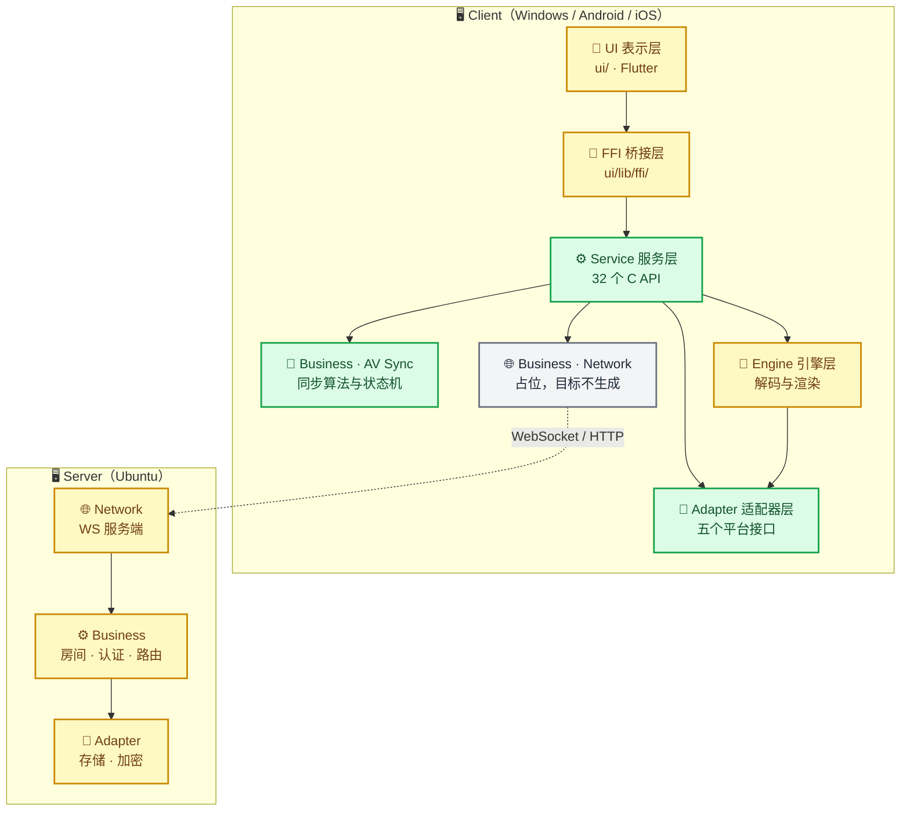
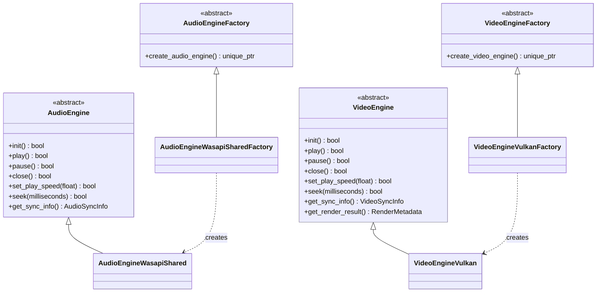

# PrismPlayer 项目架构文档

_Client 六层与 Server 三层的职责、文件与边界 · 基线 `75ba727` · 2026-11-17_

---

**本文档只回答「架构长什么样、每层有什么、边界在哪」。** 实现进度与代码行数不在这里 —— 见 `项目计划书.md` § 当前状态（唯一状态源）；目录树见同文件 § 项目文件结构；接口签名见 `API接口文档.md`；端到端时序见 `数据流.md`；术语以根目录 `GLOSSARY.md` 为准。

---

## 🖥️ 总体架构

Client 六层、Server 三层，依赖方向只有一条，不允许回指。

六层的**实际形态并不对称**：真正有实现的是 Service、Business 的 AV Sync 子模块、Adapter 五接口与 Server 三层；Engine 只有骨架；客户端 Network 只有接口头、`internal/NetImpl.h` 是 0 字节、对应目标不生成；UI 与 FFI 只有脚手架。逐项证据见 `项目计划书.md` § 当前状态。

**层间依赖与库形态**（`docs/adr/0001-分层架构与库形态.md` 定形态，ADR 0002 定门禁）：

| CMake 目标 | 形态 | 层 | 说明 |
|---|---|---|---|
| **`client-adapter`** | `STATIC` | Adapter | 五个平台抽象接口的实现 |
| `client-engine` | `SHARED` | Engine | 对外导出音视频引擎能力 |
| `client-av_sync` | `STATIC` | Business（AV Sync） | 被 Service 静态链接 |
| `client-network` | `STATIC` | Business（Network） | **目标当前不生成**：`src/` 无源文件 |
| `client-service` | `SHARED` | Service | 对外唯一 C ABI 出口，链接上面四者 |
| `Prism-server` | `EXECUTABLE` | Server | 平级链接三个 server 静态库，**不链接 client/** |

> 💡 **为什么只有两个共享库**：只有 Service 与 Engine 需要跨语言或跨进程边界导出符号，业务与适配层留在静态库里以免导出面失控；`client-network` 保持 `STATIC`，是为了它有实现后自动被 Service 吞进去，不需要改链接拓扑。

---

## 📚 Client 分层详解

### UI 层 — `ui/`

| 组件 | 说明 |
|---|---|
| **Login Page** | 用户登录/注册界面 |
| Room List | 房间列表，浏览和加入房间 |
| Player UI | 播放器主界面，视频渲染区域 + 控制栏 |
| File Sharing UI | 文件分享界面 |

- **技术**：Dart + Flutter（`ui/pubspec.yaml` 要求 `sdk: ^3.12.1`，`ffi: ^2.2.0`）
- **平台脚手架**：`android/` `ios/` `linux/` `macos/` `web/` `windows/` 全部存在，只有 Windows 有构建记录
- **负责人**：@kuailede110

> ⚠️ 上表四个页面**一个都没有实现**，`ui/lib/main.dart` 仍是官方计数器模板。
> 📌 **File Sharing UI** 依赖文件传输能力，当前只是空壳，不计入「已完成页面」。

### FFI 桥接层 — `ui/lib/ffi/`

Dart 与 C++ 之间的桥接层，设计上包含三件事：

| 设计要素 | 说明 | 现状 |
|---|---|---|
| **Dart FFI 绑定** | ffigen 从 `Player.h` 生成 `NativeLibrary`、typedef 与结构体映射 | 🟡 已生成，未接线 |
| C 函数导出 | `extern "C"` + `PRISM_API` | ✅ C++ 侧已存在 |
| Dart Isolate 通信 | 避免阻塞 UI 线程 | ⛔ 未实现 |

- **C++ 侧是现成的**：`client/service/include/Player.h` 用 `PRISM_API`（定义在 `client/common/API.h`）导出 32 个 C API，`Player.cpp` 里是 `extern "C"` 定义，ABI 已可用
- **Dart 侧已有绑定、尚无调用方**：`ui/lib/ffi/ffi_bridge.dart` 由 ffigen 从 `Player.h` 生成（1,297 行，32 个 C API + 结构体/回调），运行期仍需用 `DynamicLibrary.open` 加载 `build/client/service/libclient-service.dll` 再构造 `NativeLibrary`；Isolate 封装未做，且 `ui/lib` 里没有任何文件 import 它

### Service 层 — `client/service/`

API 门面层，把 Business 的原子能力组合成面向外部的统一接口，也是 client 唯一的 C ABI 出口。

| 职责 | 说明 |
|---|---|
| **对外 API** | 供 FFI 与二次开发调用（32 个 C API，签名见 `API接口文档.md`） |
| 功能组合 | 把 AV Sync 与 Network 组合成场景化接口 |
| 生命周期 | 持有播放器实例，管理回调与线程安全 |
| 依赖 | `client-av_sync`、`client-network`、`client-engine`、`client-adapter` |

- **文件**：`include/Player.h`（导出面）、`include/Types.h`（类型系统）、`internal/PlayerImpl.h`（内部实现）、`internal/IServiceNetwork.h`（网络抽象，当前挂默认桩）、`src/Player.cpp`
- **边界**：Service 不直接碰平台 API，一切平台差异下沉到 Engine 与 Adapter；网络能力经 `IServiceNetwork` 抽象注入，因此 Network 层没实现时 Service 仍能编译运行（返回失败而不崩溃）
- **负责人**：@RickeyDeung（AV Sync 接口）、@ambulance001（Network 接口）

### Business 层 — `client/business/`

#### AV Sync 模块

| 组件 | 职责 |
|---|---|
| **`SyncAlgorithm`** | 同步判定：`drift = video_pts - audio_pts`，超 `ahead_threshold_ms` → `WAIT`、低于 `-behind_threshold_ms` → `DROP`、否则 `RENDER` |
| `CommandDispatcher` | 向 Engine 下发播放指令，模块内最大的一块 |
| `PlaybackStateMachine` | 播放/暂停/停止/Seek 状态机 |
| `EngineObserver` | 接收 Engine 回传的帧状态 |
| `SyncFactory` | 组装上述四者 |

- **接口头**：`ISyncAlgorithm.h` / `ICommandDispatcher.h` / `IPlaybackStateMachine.h` / `IEngineObserver.h` / `SyncFactory.h` / `SyncTypes.h`
- **依赖**：Engine 层接口
- **负责人**：@RickeyDeung

> ⚠️ **这一层目前没有任何单元测试**：旧测试在 `f9ddd15` 整体删除后未补回。算法细节、7 个 `sync_state` 的迁移规则见 `设计文档.md`，接口签名见 `API接口文档.md`。

#### Network 模块（占位）

| 接口 | 职责 |
|---|---|
| **`ISignalingClient`** | WebSocket 信令客户端（用 ixwebsocket，不用 asio） |
| `IRoomManager` | 房间加入/离开 |
| `IAccountManager` | 账号认证 |
| `INetworkObserver` | 网络事件回调 |
| `NetworkFactory` | 工厂 |
| `NetworkTypes` | 公共类型 |

- **依赖**：asio、ixwebsocket、nlohmann-json、spdlog（`CMakeLists.txt` 已 `find_package`，但无源码 include）
- **负责人**：@ambulance001

> 📌 六个接口头是真的，但 `internal/NetImpl.h` 是 0 字节、`src/` 无源文件。落地时按 spec #117 决策 26–29：本层只做**传输原语**（连接/收发/重连/回调线程语义），房间与账号的业务规则留在上层；登录走 WS 不走 HTTP。

### Engine 层 — `client/engine/`

| 模块 | 技术 | 说明 |
|---|---|---|
| **解封装与解码** | FFmpeg | Demuxer、视频解码、音频解码 |
| 渲染 | Vulkan + GLFW（+ GLM 数学） | 渲染管线、纹理上传、Draw Call |
| 音频输出 | WASAPI 共享模式（Windows）、SoundTouch | PCM 输出与变速变调 |
| 跨平台扩展 | AAudio（Android）、AudioUnit（iOS） | 未开始 |

| 接口 | 头文件 |
|---|---|
| **`AudioEngine` / `VideoEngine`** | `client/engine/include/{AudioEngine,VideoEngine}.h` |
| `AudioEngineFactory` / `VideoEngineFactory` | `client/engine/include/{AudioEngineFactory,VideoEngineFactory}.h` |
| 同步与渲染类型 | `client/engine/include/` 下的 `AudioSyncInfo` / `VideoSyncInfo` / `RenderMetadata` |

- **工厂模式的理由**：平台差异只出现在「怎么创建」，接口本身与平台无关；Service 通过工厂拿抽象指针，换平台只换工厂实现
- **PTS 表示**：同步信息与 `seek` 的时间一律用 `std::chrono::milliseconds`；`seek` 只收绝对位置，相对快进/倒退由 Service 层换算（#128）
- **产出**：共享库 `client-engine`
- **负责人**：@xiaofusu123（解码与架构）

> ⚠️ `src/` 下只有 4 个 `.cpp`（WASAPI 与 Vulkan 的骨架与工厂），**没有真实 WASAPI 调用、没有 Vulkan 初始化/交换链/纹理上传、没有任何 FFmpeg 源文件**。

### Adapter 层 — `client/adapter/`

平台能力抽象。每个接口都有一份 `include/` 下的纯虚声明 + 一份 `internal/` 下的实现声明 + 一份 `src/` 下的实现。

| 接口（`include/`） | 实现（`internal/` + `src/`） | 职责 |
|---|---|---|
| **`FileAdapter`** | `WinFileAdapter` | 文件读写与元数据，`std::filesystem` |
| `DBAdapter` | `SQLiteDBAdapter` | 本地库四张表 |
| `NetworkAdapter` | `ASIONetworkAdapter` | 字节级 HTTP/WS 传输（底层 ixwebsocket） |
| `ConfigAdapter` | `JSONConfigAdapter` | 配置文件点号路径读写 |
| `CryptoAdapter` | `OpenSSLCryptoAdapter` | 口令哈希 + 内存 buffer AEAD |

- **依赖方向**：Adapter 不认识任何上层，只依赖标准库与五个第三方库（sqlite3 / OpenSSL / ixwebsocket / nlohmann-json / spdlog）；上层通过接口指针使用，**Adapter 之间互不依赖**（`FileAdapter` 不知道 `ConfigAdapter` 存在）
- **无全局状态**：五个实现都设计成可并发调用的实例对象，静态库内不放全局单例（ADR 0001 / spec #117 决策 3）
- **负责人**：@Rikka2-aa

> 🚫 **不要往 `CryptoAdapter` 里加回 `encrypt_file` / `decrypt_file`**：文件级分块加密由 `FileCipher` / `OpenSSLFileCipher` 承载（`docs/adr/0007-文件加密与AES-256-GCM.md`），该项尚未实现（#166）。`CryptoAdapter` 只服务「口令哈希」与「内存 buffer 加解密」两项。

**已知边界（写实现的人必须知道）**：

| # | 边界 | 影响 |
|---|---|---|
| **1** | `get_metadata()` 只填路径、大小、扩展名格式三项 | 不要指望它探出时长/码率 |
| 2 | `FileAdapter::open()` 对不存在的路径**新建空文件** | 与 spec #117 决策 8 相反，属待修偏差 |
| 3 | `include/` 下**没有** Adapter 工厂头 | 上层目前自己 `new` 具体实现，是临时状态 |
| 4 | `ASIONetworkAdapter` 这个类名不准确 | 它没用 asio，HTTP/WS 都走 ixwebsocket |

第 3 条是有意的：引入 Adapter 工厂要等 Engine/Service 侧的注入方式定下来，提前加会多一层没人用的间接。

---

## 🌐 Server 架构

三层，与客户端同构但职责不同：Server 只做「房间 + 认证 + 消息转发」，不碰音视频解码。

| 层 | 目录 | 职责 | 主要文件 |
|---|---|---|---|
| **Network** | `server/network/` | WS 服务端、会话管理 | `IxWebSocketServer`、`SessionManager`、`NetworkFactory` |
| Business | `server/business/` | 认证、房间、消息路由 | `AuthService`、`RoomManager`、`MessageRouter`、`BusinessFactory` |
| Adapter | `server/adapter/` | 存储与加密 | `InMemoryDbAdapter`、`OpenSSLCryptoAdapter`、`AdapterFactory` |

- **命名空间**：`Prism::Server::{Network,Business,Adapter}`，与目录一一对应
- **形态**：三个静态库 + 一个可执行文件 `Prism-server`（`main.cpp` 只做初始化与工厂装配）
- **存储可替换**：`DbAdapter` 由 `AdapterFactory` 显式选择实现，当前只有 `InMemoryDbAdapter`（进程内，重启即丢）
- **不链接 client/**：Server 与客户端不共享代码，跨侧一致性靠夹具验证而不是共享头文件（spec #117 决策 25 / 42）
- **负责人**：@RickeyDeung（2026-10-16 起接 Server 端）

**与客户端的已知差异**：

| 差异 | 说明 |
|---|---|
| **口令校验签名** | 客户端是 `verify_password(password, credential)` 两参数（credential 为自描述串）；`server/adapter/include/CryptoAdapter.h` 仍是 `verify_password(password, hash, salt)` 三参数。统一之前不要把服务端实现当参考 |
| 平台库 | `server/network/CMakeLists.txt` 在 Windows 下额外链接系统库 `bcrypt`；Linux 不需要（Server 目标平台是 Ubuntu） |
| 目标平台 | 只在 Ubuntu 24.04 的 CI 上从零构建过，从未与客户端联调 |

> 📌 Server 端两个历史上的坑都已处理：`CmakeLists.txt` 大小写已统一（2026-10-11），目标随 `src/` 非空自动生成。MySQL 依赖至今不在 `vcpkg.json` 的 `server` feature 里，是 #83 的前置条件。

---

## 📦 Vendor

`vendor/` **不在根构建里**：根 `CMakeLists.txt` 只 `add_subdirectory` 了 `client`、`server`（Debug 另加 `test`）。两个子项目的设计说明见 `设计文档.md`。

| 子项目 | 内容 | 构建状态 |
|---|---|---|
| **`threadpool/`** | `ThreadPool` 头 + 实现 + 三个测试程序（benchmark / load / stress，共用 `test/common.hpp`），自身 `enable_testing()` + `add_test()` | 未接入根构建，**那套测试一次都没跑过** |
| `memorypool/` | `src/MemoryPool.cpp` 0 字节，`include/MemoryPool.h` 5 行且命名空间写成了 `ThreadPool` | **已决定暂不处理**：不删除、不加根构建 |

> 📌 `memorypool/CmakeLists.txt` 的文件名是小写 `m`（`CmakeLists.txt` 而非 `CMakeLists.txt`），与仓库命名约定不符，随「暂不处理」一并保留。

---

## 🔧 Practice

试验代码目录，**未被 git 跟踪**（`.gitignore` 忽略），不在版本控制与构建中，只作设计参考。唯一值得读的是 `practice/AudioDecoder.h`，它描述了音频解码器的目标形态（`init(config)` / `sync_decode` / `async_decode` / `restart` / `stop` / `flush` / `reset` / `free` / 状态查询，配合 7 态 `sync_state`），正版实现落地时应按 `代码规范.md` 命名重写，不要直接拷贝。

三个已知缺陷（拷贝前必读）：

| 缺陷 | 位置 |
|---|---|
| **`audio_decoder_info` 类型全仓无定义** | 声明处引用了一个不存在的类型 |
| 命名空间不一致 | 文件头 `namespace Prism::Engine`，尾部注释写 `Prism::engine` |
| 命名违规 | `isRunning()` 违反 `代码规范.md` 的 snake_case |

---

## ⚙️ 构建系统

### 预设

`CMakePresets.json` 是 version 10 格式，结构是 **2 个隐藏基预设 + 6 配置 + 6 构建 + 6 测试预设**：

| 维度 | 取值 |
|---|---|
| **基预设（hidden）** | `windows-base`、`linux-base` |
| 配置预设 | `windows-clang-x64-{Debug,Release,Coverage}`、`linux-clang-x64-{Debug,Release,Coverage}` |
| 输出目录 | `build/{Windows,Linux}/{debug,release,coverage}` |
| manifest features | Debug/Coverage 为 `client;server;test`；Release 只 `client;server`（不带 gtest） |
| 工具链 | Windows 走 `CLANG_ROOT`（`D:\Program\Dev\msys64\mingw64\bin` 的 mingw64 clang）、`VCPKG_ROOT`（`D:\Program\Dev\Vcpkg\vcpkg`）、cmake 在 `D:\Program\Dev\CMake\bin\cmake.exe`；Linux 走 `/usr/bin/clang` 与 `$HOME/vcpkg` |

> 📌 真正的编译/安装/验收命令、工具版本要求、vcpkg baseline、缓存与 `--clean` 语义、实测耗时与产物体积阈值，**只在 `AGENTS.md` 里维护**（门禁规则的理由见 `docs/adr/0002-代码门禁.md` 与 `0006-门禁第二阶段CI.md`），本文档不复制这些细节。

### 构建目标清单

一次 Debug 配置产出的链接目标：

| 目标 | 来源 | 说明 |
|---|---|---|
| **`client-adapter`** | `client/adapter/` | 静态库 |
| `client-engine` | `client/engine/` | 共享库 |
| `client-av_sync` | `client/business/av_sync/` | 静态库 |
| `client-service` | `client/service/` | 共享库 |
| `client-network` | `client/business/network/` | **不生成**：`src/` 无源文件，`if(SRC)` 不成立 |
| `server-adapter` / `server-business` / `server-network` | `server/*/` | 静态库，2026-11 起非空 |
| `Prism-server` | `server/main.cpp` | 可执行文件 |
| `test-engine` / `test-adapter` | `test/{engine,adapter}/` | 仅 Debug；`test/business`、`test/service`、`test/server` 无源文件故不生成 |

`scripts/build/verify-build.*` 对其中 4 个业务产物（`client-engine`、`client-av_sync`、`client-service`、`Prism-server`）做存在性与体积断言，并检查依赖安装树、`prism_player_*` 导出数与「不得链接 libc++」。

> ⚠️ **`client-adapter` 不在断言列表里** —— #118 / #121 的验收项之一。
