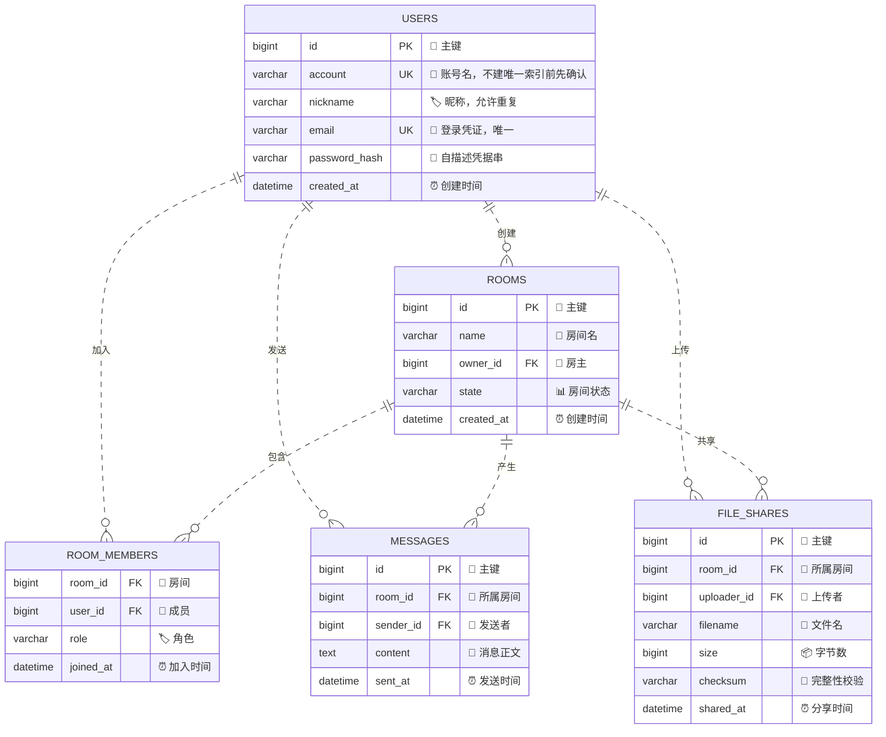

# PrismPlayer 项目计划书

_项目负责人 @xiaofusu123 · 起书 2026.4.30 · 最后更新 2026-11-17（基线 `75ba727`）_

---

**本文档回答「要做什么、做到哪一步、数据存在哪」。** 其余问题看别处，不要在这里重复：

| 想知道 | 看 |
|---|---|
| 各层怎么组织、每层有哪些文件、边界在哪 | `项目框架.md` |
| 为什么选 WASAPI / Vulkan / ixwebsocket，否决了什么 | `设计文档.md` |
| 一次播放请求在六层之间怎么流动 | `数据流.md` |
| 某个接口/结构体的签名与语义 | `API接口文档.md` |
| 命名、格式、提交与合并规矩 | `代码规范.md` |
| 术语的准确定义与不同叫法 | 根目录 `GLOSSARY.md` |

状态标记全文只有四个词，不写「基本完成」这类无法证伪的说法：✅ 已落地 / 🟡 仅骨架 / 📐 仅设计 / ⛔ 未开始。

`docs/markdown/*.md` 是唯一真源（ADR 0003）：`项目计划书.docx` / `代码规范.docx` 已于 2026-11-02 随 `docs/archive/` 删除，内容全量并入 md，`docs/docx/` 不再存在。

---

## 📋 项目概述

**项目名称**：PrismPlayer（棱镜播放器）

**项目内容**：跨平台音视频播放器，支持本地播放与联机同步播放。

| 端 | 平台 | 系统 | 现状 |
|---|---|---|---|
| 客户端 | Windows x64 | 26H2 | 唯一真正构建过的目标 |
| 客户端 | Android / iOS | — | 只有 Flutter 脚手架，无构建记录 |
| 服务端 | Linux | Ubuntu | 已能在 CI（Ubuntu 24.04）从零构建，未联调 |

**功能范围**：

| 模块 | 功能 |
|---|---|
| 本地播放 | 本地音乐播放、本地视频播放 |
| 联机播放 | 一起听音乐、一起看视频 |
| 社交 | 联机房间、聊天室 |
| 传输 | 音视频文件分享 |

---

## 🔧 技术选型

| 类别 | 选型 | 版本 | 备注 |
|---|---|---|---|
| 数据库（客户端） | SQLite | 3.x | 已进 manifest 并接线，四张表已建（见「数据库设计」） |
| 数据库（服务端） | MySQL | 8.x | **尚未声明依赖**，当前用内存实现 |
| C 编译器 | Clang | 23.1.x（C17） | 工具链根目录走机器级 `CLANG_ROOT`；门禁只比对前缀 `23.1` |
| C++ 编译器 | Clang++ | 23.1.x（C++17） | 同上；Windows 侧必须用 **mingw64** 的 clang |
| 构建系统 | Ninja | 1.13.x | 实际是 `%CLANG_ROOT%\ninja.exe` |
| 构建语言 | CMake | 4.x（本机 4.4.x） | `CMakePresets.json` 为 version 10 格式 |
| 前端语言 | Dart | 3.x（本机 3.12.x） | `ui/pubspec.yaml` 要求 `sdk: ^3.12.1` |
| 前端 UI | Flutter | 3.x（本机 3.44.x） | — |

> 💡 **版本一律写到次版本并以 `x` 结尾**：补丁位随安装更新，写死会反复过期。2026-11-02 本机实测 clang 23.1.4、cmake 4.4.4、ninja 1.13.2、Flutter 3.44.1、Dart 3.12.1。

> 📌 **为什么 Windows 必须用 mingw64 的 clang**：vcpkg 的 `x64-mingw-dynamic` 依赖由同环境 GCC / libstdc++ 编译，clang64 的 clang 默认 libc++，跨标准库会让 `fmt` / `spdlog` 符号解析成两套 ABI，`libclient-service.dll` 链接失败。完整报错见 `项目框架.md` § 构建系统。

---

## 📦 第三方库

判定口径：

| 状态 | 含义 |
|---|---|
| ✅ 已使用 | 有 `find_package`，且源码里真的 `#include` 了 |
| 🟡 已接线未使用 | CMake 里有 `find_package`，但没有任何源码 `#include` |
| 📐 已声明未接线 | 只在 `vcpkg.json` 里声明，CMake 里没有 `find_package` |
| ⛔ 计划内未声明 | 文档里写了要用，但 `vcpkg.json` 里根本没有 |

| 类别 | 库 | 用途 | 状态 | 证据 |
|---|---|---|---|---|
| **工具** | `spdlog` | 日志输出 | ✅ 已使用 | 9 个 `CMakeLists.txt` 有 `find_package`；`#include <spdlog/spdlog.h>` 遍布 client 与 server |
| 数据 | `nlohmann-json` | JSON 编解码 | ✅ 已使用 | `client/adapter/internal/JSONConfigAdapter.h:2`、`server/business/src/{RoomManager,MessageRouter}.cpp`、`server/network/src/IxWebSocketServer.cpp:12` |
| 数据 | `openssl` | 口令哈希、AEAD | ✅ 已使用 | 两侧 `OpenSSLCryptoAdapter.cpp`；`find_package(OpenSSL)` 在两端 adapter |
| 网络 | `ixwebsocket` | WS 客户端/服务端 | ✅ 已使用 | `client/adapter/src/ASIONetworkAdapter.cpp:3-5`、`server/network/src/IxWebSocketServer.cpp:9-10` |
| 数据 | `sqlite3` | 本地数据库 | ✅ 已使用 | `client/adapter/src/SQLiteDBAdapter.cpp`；`unofficial-sqlite3` 回退 `FindSQLite3` |
| **工具** | `gtest` | 单元测试 | ✅ 已接线（仅 Debug） | `test/` 下 3 个用例文件、28 个用例 |
| 音视频 | `ffmpeg` | 解封装、编解码 | 🟡 已接线未使用 | `client/engine/CMakeLists.txt:9`；`src/` 无任何 ffmpeg 源文件 |
| 渲染 | `vulkan` | GPU 渲染管线 | 🟡 已接线未使用 | `client/engine/CMakeLists.txt:10` |
| 渲染 | `glfw3` | 窗口管理 | 🟡 已接线未使用 | `client/engine/CMakeLists.txt:11` |
| 音视频 | `soundtouch` | 音频变速变调 | 🟡 已接线未使用 | `client/engine/CMakeLists.txt:12` |
| 网络 | `asio` | 异步网络 I/O | 🟡 已接线未使用 | 两处 `find_package`；**全仓零 `#include <asio…>`** |
| 渲染 | `glm` | 数学库 | 📐 已声明未接线 | manifest 的 `client` feature 里有，全仓无 `find_package` |
| 音视频 | `libplacebo` | 视频后处理（计划） | ⛔ 计划内未声明 | 见 `docs/adr/0004-渲染与音频后端.md` |
| 数据 | MySQL 客户端 | 服务端持久化（计划） | ⛔ 计划内未声明 | 表结构与查询均未落库，落地票 **#83** |

`vcpkg.json` 的 features：

| feature | 内容 |
|---|---|
| `client` | asio、ffmpeg、glfw3、glm、ixwebsocket、nlohmann-json、openssl、soundtouch、spdlog、sqlite3、vulkan |
| `server` | asio、ixwebsocket、nlohmann-json、openssl、spdlog |
| `test` | gtest |

`default-features` 为 `["client"]`。

> ⚠️ **`ASIONetworkAdapter` 这个类名不准确**：它没有用 asio，HTTP 与 WS 都走 `ixwebsocket` 的 `IXHttpClient` / `IXWebSocket`。asio 至今只在两处 `find_package` 里出现过，没有一行代码消费它。

---

## 🖥️ 架构概览

客户端六层、服务端三层，层与层的依赖方向只有一条：

```text
客户端：UI(Flutter) → FFI(Dart↔C++) → Service(C API) → Business(AV Sync / Network)
                                                      → Engine(音视频)
                                                      → Adapter(文件/DB/网络/配置/加密)

服务端：Network(WS) → Business(房间/认证/消息) → Adapter(存储/加密)
```

| 层 | CMake 目标 | 形态 | 一句话职责 |
|---|---|---|---|
| **Service** | `client-service` | SHARED | 32 个 C API 门面 |
| Business（AV Sync） | `client-av_sync` | STATIC | `drift` 判定与播放状态机 |
| Business（Network） | `client-network` | STATIC | 信令/房间/账号（占位） |
| Engine | `client-engine` | SHARED | 音视频解码与渲染 |
| Adapter | `client-adapter` | STATIC | 五个平台抽象接口 + 实现 |
| Server | `Prism-server` | EXECUTABLE | WS 服务、房间、认证 |

每层的目录、头文件清单与边界见 `项目框架.md`。

---

## 👥 人员分工

> 📌 仓库是 **PUBLIC**，成员一律用 GitHub 登录名标识，不使用真名。

| 成员 | 负责模块 | 说明 |
|---|---|---|
| **@xiaofusu123** | 整体架构、Engine 层、构建与基线、文档与规范 | 项目负责人 |
| @RickeyDeung | Service 层、Business 层 AV Sync、Server 端 | 2026-10-16 起接 Server |
| @ambulance001 | Business 层 Network | 实时通信、文件传输 |
| @kuailede110 | UI 层（Flutter） | 已退出本仓库协作，分工不变，GitHub 协作者权限仍保留 |
| @Rikka2-aa | 数据库设计、Adapter 层 | 数据持久化 |

---

## 🗂️ 项目文件结构

只列 git 跟踪的内容；`ui/` 只列到源码层。

```text
PrismPlayer/
├── client/
│   ├── common/                    # API.h（PRISM_API 导出宏）、pch.h（0 字节，未接线）
│   ├── adapter/                   # 静态库 client-adapter
│   │   ├── include/               # 5 个抽象接口：Config / Crypto / DB / File / NetworkAdapter
│   │   ├── internal/              # 5 个平台实现的声明
│   │   └── src/                   # 5 个 .cpp，共 1,706 行
│   ├── business/
│   │   ├── av_sync/               # 静态库 client-av_sync ★ 真实实现，5 个 .cpp 共 323 行
│   │   └── network/               # 静态库 client-network ※ 占位：6 个接口头 + 0 字节 NetImpl.h
│   ├── engine/                    # 动态库 client-engine ※ 仅骨架，4 个 .cpp 共 69 行
│   └── service/                   # 动态库 client-service ★ Player.cpp 436 行 / 32 个 C API
│
├── ui/                            # Flutter 项目（含 FFI 桥接）
│   ├── lib/main.dart              # 仍是官方计数器模板
│   ├── lib/ffi/ffi_bridge.dart    # ffigen 生成，32 个 C API 绑定
│   └── {android,ios,linux,macos,web,windows}/
│
├── server/                        # 可执行文件 Prism-server
│   ├── adapter/  business/  network/   # ★ 真实实现，共 655 行
│   └── main.cpp                   # 23 行：初始化与工厂装配
│
├── vendor/
│   ├── threadpool/                # ★ ThreadPool.h 87 行 + .cpp 109 行 + 3 个测试程序（未接入根构建）
│   └── memorypool/                # 空壳：MemoryPool.cpp 0 字节；已决定暂不处理
│
├── test/                          # engine/ adapter/ 有源文件；business/ server/ service/ 只有 CMakeLists
├── docs/
│   ├── markdown/                  # ★ 唯一真源：6 份文档
│   ├── adr/                       # 架构决策记录 0001–0007
│   ├── agents/                    # issue-tracker / triage-labels / domain
│   └── plans/  specs/             # 2026-10-18 的 server 实现计划与设计说明
├── practice/                      # 试验代码（被 .gitignore 忽略，不在版本控制与构建中）
├── build/                         # 构建输出（被忽略）
├── CMakeLists.txt                 # 根 CMake（client / server；Debug 另加 test）
├── CMakePresets.json              # 6 配置 + 6 构建 + 6 测试预设
├── vcpkg.json / vcpkg-configuration.json
├── scripts/                       # build/、checks/、ci/、hooks/、tests/、tool/（wsl-env.sh、ffigen.*）
└── AGENTS.md                      # Agent 协作说明
```

`client/adapter/src/` 五个实现：

| 实现 | 行数 | 职责 |
|---|---|---|
| `WinFileAdapter.cpp` | 187 | 文件读写与元数据 |
| `JSONConfigAdapter.cpp` | 223 | 配置文件点号路径读写 |
| `ASIONetworkAdapter.cpp` | 313 | 字节级 HTTP/WS 传输 |
| `OpenSSLCryptoAdapter.cpp` | 375 | 口令哈希 + 内存 buffer AEAD |
| `SQLiteDBAdapter.cpp` | 608 | 本地四张表 |

> 📌 根 `CMakeLists.txt` 只 `add_subdirectory` 了 `client`、`server`（Debug 另加 `test`）。`vendor/`、`practice/` 都不在构建里。

---

## 🚀 开发阶段规划

推进顺序是一条线，各阶段目标与落地程度如下。


### 阶段一：基础设施搭建

| 项 | 状态 | 依据 |
|---|---|---|
| 项目骨架（CMake + vcpkg） | ✅ | 根 `CMakeLists.txt`、`vcpkg.json`、`CMakePresets.json` |
| Engine 层抽象接口 | ✅ | `client/engine/include/` 6 个头 |
| 构建系统（Ninja + Clang） | ✅ | 6 配置 + 6 构建 + 6 测试预设；`verify-build` 20 项断言全过 |
| Adapter 五接口 + 依赖接线 | ✅ | PR #159 落地五个实现与 `find_package`（sqlite3 / OpenSSL / ixwebsocket），静态库非空 |
| Vendor 库 | 🟡 | ThreadPool 真实现（196 行）但**未接入根构建**；MemoryPool 空壳，已决定暂不处理 |

### 阶段二：Engine 层实现

| 项 | 状态 | 依据 |
|---|---|---|
| WASAPI 共享模式音频引擎骨架 | ✅ | `AudioEngineWasapiShared.cpp` 26 行 + 工厂 7 行（无真实 WASAPI 调用） |
| Vulkan 视频引擎骨架 | ✅ | `VideoEngineVulkan.cpp` 29 行 + 工厂 7 行 |
| FFmpeg 集成与解封装 | ⛔ | `src/` 下没有任何 FFmpeg 源文件 |
| 音频解码器实现 | ⛔ | 无源文件；仅有 `practice/AudioDecoder.h`（133 行设计稿，未被 git 跟踪） |
| 视频解码器实现 | ⛔ | 无源文件 |
| SoundTouch 变速集成 | ⛔ | 无源文件 |
| Vulkan 渲染管线 | ⛔ | 无初始化、无交换链、无纹理上传 |

> 📌 阶段二的四个 ⛔ 是同一条链路上的四段，落地票为 #128–#135 系列（Engine / AV Sync 线）。

### 阶段三：业务层实现

| 项 | 状态 | 依据 |
|---|---|---|
| AV Sync 同步算法 | ✅ | `SyncAlgorithm.cpp` 47 行：`drift = video_pts - audio_pts`，超 `ahead_threshold_ms` → `WAIT`、低于 `-behind_threshold_ms` → `DROP`、否则 `RENDER` |
| 播放状态机 | ✅ | `PlaybackStateMachine.cpp` 65 行 |
| 命令分发与引擎观察者 | ✅ | `CommandDispatcher.cpp` 130 行 + `EngineObserver.cpp` 58 行 + `SyncFactory.cpp` 23 行 |
| WebSocket 信令客户端 | ⛔ 占位 | `ISignalingClient.h` 40 行；`internal/NetImpl.h` 0 字节 |
| 房间管理 | ⛔ 占位 | `IRoomManager.h` 42 行 |
| 账号认证 | ⛔ 占位 | `IAccountManager.h` 39 行 |

> ⚠️ **AV Sync 四个组件没有任何单元测试**：`f9ddd15` 删掉 4 个旧测试后一直没补（`test/business/` 里只有 CMakeLists）。这是阶段六之前的缺口。

### 阶段四：Service + FFI 层

| 项 | 状态 | 依据 |
|---|---|---|
| Service 层 C API 门面 | ✅ | `Player.h` 里 `PRISM_API` 出现 32 次，`Player.cpp` 32 个定义，无缺失 |
| Service 层内部实现 | ✅ | `PlayerImpl.h` 58 行 + `IServiceNetwork.h` 51 行（网络侧是默认桩） |
| Flutter 项目脚手架 | ✅ | `ui/` 全平台脚手架 + `pubspec.yaml`（`ffi: ^2.2.0`） |
| Flutter UI 框架 | ⛔ | `ui/lib/main.dart` 仍是计数器模板 |
| Dart 侧 FFI 绑定 | 🟡 | `ffi_bridge.dart` 由 ffigen 生成 1,297 行，覆盖 32 个 C API；尚无调用方与 Isolate 封装 |

### 阶段五：UI + Server

| 项 | 状态 | 依据 |
|---|---|---|
| Server 目录与命名统一 | ✅ | `server/*/CMakeLists.txt` 均为大写（`vendor/` 下仍是小写，已决定暂不处理） |
| Flutter 播放器界面 | ⛔ | 未开始 |
| 房间列表与聊天界面 | ⛔ | 未开始 |
| Server 端 WebSocket 服务 | 🟡 | #150 落地 `IxWebSocketServer` 216 / `SessionManager` 77 / `NetworkFactory` 7 行，未联调 |
| 用户认证与房间管理后端 | 🟡 | #147 落地 `AuthService` 42 / `RoomManager` 54 / `MessageRouter` 25 / `BusinessFactory` 18 行；数据层是 `InMemoryDbAdapter`，MySQL 未接 |

### 阶段六：联调与测试

| 项 | 状态 | 依据 |
|---|---|---|
| 端到端播放测试 | ⛔ | 未开始 |
| 多客户端同步播放测试 | ⛔ | 未开始 |
| 单元测试覆盖率 80%+ | ⛔ | 期望值，非门禁。`coverage` CI job 只出数字不设阈值（#84） |
| 性能优化与 Bug 修复 | ⛔ | 未开始 |

---

## 💾 数据库设计

本节是表结构的唯一真源：`设计文档.md` 只谈选型理由，`API接口文档.md` 只给接口签名。

### 客户端（SQLite，已落地）

由 `SQLiteDBAdapter::init()` 在一个事务里建表（`client/adapter/src/SQLiteDBAdapter.cpp:26-66`），四张表：

```sql
CREATE TABLE IF NOT EXISTS accounts (
    id            INTEGER PRIMARY KEY AUTOINCREMENT,
    username      TEXT    NOT NULL UNIQUE,
    email         TEXT    NOT NULL,
    password_hash TEXT    NOT NULL
);
CREATE TABLE IF NOT EXISTS audio_files (
    id              INTEGER PRIMARY KEY AUTOINCREMENT,
    title           TEXT    NOT NULL,
    file_path       TEXT    NOT NULL,
    file_size       INTEGER NOT NULL DEFAULT 0,
    cover_path      TEXT    NOT NULL DEFAULT '',
    artist          TEXT    NOT NULL DEFAULT '',
    encoding_format TEXT    NOT NULL DEFAULT '',
    duration        INTEGER NOT NULL DEFAULT 0,
    bit_depth       INTEGER NOT NULL DEFAULT 0,
    sample_rate     INTEGER NOT NULL DEFAULT 0,
    bit_rate        INTEGER NOT NULL DEFAULT 0,
    channels        INTEGER NOT NULL DEFAULT 0,
    channel_layout  TEXT    NOT NULL DEFAULT '',
    lyrics_path     TEXT    NOT NULL DEFAULT ''
);
CREATE TABLE IF NOT EXISTS video_files (
    id                INTEGER PRIMARY KEY AUTOINCREMENT,
    filename          TEXT    NOT NULL,
    file_path         TEXT    NOT NULL,
    file_size         INTEGER NOT NULL DEFAULT 0,
    author            TEXT    NOT NULL DEFAULT '',
    resolution_width  INTEGER NOT NULL DEFAULT 0,
    resolution_height INTEGER NOT NULL DEFAULT 0,
    color_depth       INTEGER NOT NULL DEFAULT 0,
    duration          INTEGER NOT NULL DEFAULT 0,
    encoding_format   TEXT    NOT NULL DEFAULT '',
    frame_rate        REAL    NOT NULL DEFAULT 0,
    bit_rate          INTEGER NOT NULL DEFAULT 0
);
CREATE TABLE IF NOT EXISTS settings (
    "key"   TEXT PRIMARY KEY,
    "value" TEXT NOT NULL
);
```

设计约束（spec #117 / #121）：

- **媒体文件表不设外键、不归属账号** —— 本地库天然只属于本机用户，这一点与服务端的关系模型不同，实现时不要照搬。
- 四张表的列与 `AccountInfo` / `AudioFileInfo` / `VideoFileInfo` 结构体字段**一一对应**，不出现「库里没人读的列」。
- 所有 SQL 走预处理语句与绑定参数，不拼字符串；`sqlite3_open_v2` 用 `READWRITE|CREATE|FULLMUTEX`。

> ⚠️ **两处与 spec 的偏差（未修，见 #121）**
>
> 1. 唯一性做反了 —— spec 要求**邮箱唯一、昵称不唯一**（邮箱当登录凭证），代码里是 `username UNIQUE`、`email` 无唯一约束，用例 `DuplicateUsernameIsRejected` 也按错的约束写。
> 2. spec 要求 schema 版本走 `PRAGMA user_version`（当前期望值 1）、库版本高于程序时失败；代码里**完全没有 `user_version`**（全文件零 `PRAGMA`）。

### 服务端（MySQL，计划）

五类表：用户、房间、房间成员、消息、文件分享记录。当前数据层是 `server/adapter/src/InMemoryDbAdapter.cpp`（114 行，进程内存储，重启即丢）。



> 📌 `ROOM_MEMBERS` 的 `(room_id, user_id)` 建联合唯一索引，同时作为「是否已在房间内」的判据；`USERS.account` 的唯一性是待确认项 —— spec 只要求邮箱唯一，`account` 列加 `UK` 标注表示需要显式决策。

落地票 **#83**（被 Server 骨架票阻塞）：MySQL 客户端不在 `vcpkg.json` 的 `server` feature 里，表结构与查询都还没有实现。

### 查询 SQL 的优化要求

服务端 MySQL 的查询至少要满足：

1. **高频查询走索引** —— `ROOM_MEMBERS(room_id, user_id)` 联合唯一索引；`MESSAGES(room_id, sent_at)` 联合索引，支撑「拉取房间最近 N 条消息」；
2. **避免 N+1** —— 房间列表页需要「房间 + 成员数 + 房主昵称」，用一次 `JOIN` + `GROUP BY` 取回，不要每行再查一次；
3. **避开 `SELECT *`** —— 列表查询只取需要的列，`content`（`TEXT`）不进列表页；
4. **分页用键集分页** —— 消息列表按 `sent_at` 游标翻页，不用 `LIMIT offset`（大房间下 offset 会线性变慢）；
5. **写路径走事务** —— 房间状态变更用事务包住「更新房间 + 写成员表」，避免房主掉线时留下半截状态。

验收手段是 `EXPLAIN`：上述查询的 `type` 不得出现 `ALL`（全表扫）。

---

## 🏁 里程碑

| 时间 | 里程碑 | 状态 | 备注 |
|---|---|---|---|
| **2026.4.30** | 项目启动，架构设计 | ✅ | 首提交 `68cc4cf` |
| 2026.5.10 | 项目骨架搭建（CMake + vcpkg） | ✅ | — |
| 2026.5.22 | 分层目录创建，Engine 接口定义 | ✅ | — |
| 2026.5.30 | Engine 层工厂模式 + WASAPI/Vulkan 骨架 | ✅ | 当时 75 行，现为 69 行 |
| 2026.6.4 | AV Sync 模块完整实现（4 个子系统） | ✅ | 323 行 |
| 2026.6.x | Flutter 项目初始化 | ✅ | 只到脚手架，UI 未搭 |
| 2026.6.x | Service 层完整实现（32 个 C API） | ✅ | `Player.cpp` 436 行 |
| 2026.11.02 | Adapter 五接口落地 + 依赖接线（#58 / PR #159） | ✅ | 静态库 1,706 行，adapter 用例 22 个 |
| 2026.11.02 | 门禁第二阶段 CI（#96）与测试跑道（#54） | ✅ | 六个必需检查 job；`ctest` 接回 |
| **TBD** | Engine 层解码实现 | ⛔ | 见阶段二 |
| TBD | 客户端 Network 与 UI/FFI | ⛔ | 见阶段三、阶段四 |
| TBD | 联调与测试 | ⛔ | 见阶段六 |

---

## 📊 当前状态

> 📌 本节是对磁盘代码的实测记录，**判定日期 2026-11-17，基准提交 `75ba727`**。与前文的「计划」冲突时以本节为准；各模块的逐项行数与落地程度见 `项目框架.md`。

### 一句话结论

**文档仍系统性超前于代码，但超前的位置已经收窄到三处**：Engine 解码（4 个 `.cpp` 共 69 行、零 FFmpeg）、客户端 Network（`NetImpl.h` 0 字节、目标不生成）、UI/FFI（计数器模板 + 已生成、未接线的 FFI 绑定）。其余有真实实现的是：Service（`Player.cpp` 436 行 / 32 个 C API）、AV Sync（323 行）、Adapter（1,706 行 / 五个实现）、Server 三层（655 行）、`vendor/threadpool`（196 行 + 306 行测试）。

### 编译产物印证

下表是 **2026-11-02 Windows Debug 的历史实测值**。当前 checkout 的 `build/Windows/` 下没有有效 Debug 树（只剩 `coverage/`、`debug.stale-20261107/`、`release/`），重新度量需要一次完整构建，因此保留历史值并标注日期。

| 产物 | 大小 | 含义 |
|---|---|---|
| `client/business/av_sync/libclient-av_sync.a` | 30,515,172 B | 含真实目标文件（Debug 带调试信息） |
| `client/engine/libclient-engine.dll` | 212,363 B | 有内容（接口桩） |
| `client/service/libclient-service.dll` | 20,036,909 B | 导出全部 32 个 C API |
| `client/adapter/libclient-adapter.a` | 18,719,806 B | 含 5 个实现的目标文件（此前是 832 B 空归档） |
| `server/Prism-server.exe` | 52,975,790 B | server 三层实现 + 静态链接依赖，Debug 未剥离 |
| `libclient-network.a` | 不生成 | `src/` 无源文件，`if(SRC)` 不成立 |
| `server-{adapter,business,network}.a` | 均已非空 | 2026-11 起 `src/` 非空 |

Flutter 侧无任何构建产物。

### 空壳与 0 字节文件

| 位置 | 情况 |
|---|---|
| **`client/common/pch.h`** | 0 字节，预编译头**保留但未接线**（全仓无 `target_precompile_headers()`、无人 include） |
| `client/business/network/internal/NetImpl.h` | 0 字节；`src/` 无源文件，`client-network` 不生成 |
| `client/engine/src/` | 4 个文件共 69 行，无解码实现 |
| `server/main.cpp` | 23 行（初始化与工厂装配） |
| `vendor/memorypool/` | `src/MemoryPool.cpp` 0 字节；`include/MemoryPool.h` 5 行且命名空间写成 `ThreadPool`；`CmakeLists.txt` 小写 `m`。**已决定暂不处理**：不删除、不加根构建 |
| `vendor/threadpool/` | 有实现，但 `vendor/` 不在根构建里，那套 GTest 测试一次都没跑过 |
| `practice/AudioDecoder.h` | 133 行设计稿，**未被 git 跟踪**（`.gitignore:5`），不在构建中 |
| `ui/lib/` | `main.dart` 是计数器模板；`ffi_bridge.dart` 为 ffigen 生成的 1,297 行绑定，无调用方 |
| `test/{business,server,service}/` | 只有 `CMakeLists.txt`，无源文件 → 不生成测试目标 |

### 门禁与测试

**本地钩子**（`pre-commit` / `pre-push`）与**服务端 CI**（`.github/workflows/gate.yml`，六个必需检查 job）都在版本控制里，判定逻辑统一在 `scripts/checks/`，安装方式与实测耗时见 `AGENTS.md`「代码门禁」，规则集理由见 `docs/adr/0002-代码门禁.md`。

**用例现状**：`test/` 下 3 个源文件共 **28 个用例** —— `test/engine/` 6 个（引擎冒烟）、`test/adapter/test_openssl_crypto_adapter.cpp` 13 个（哈希/校验/双套件 AEAD/篡改拒绝）、`test/adapter/test_sqlite_db_adapter.cpp` 9 个（CRUD 往返/重复键/设置 upsert/未 init 拒绝）。AV Sync、Service、Server 侧均无用例。

**覆盖率**：`bash scripts/build/coverage.sh` 出 LLVM source-based 报告，CI 的 `coverage` job 只上传报告、**不设阈值也不阻断**（#84；原因是 AV Sync 尚无测试，数字没有代表性）。

**产物契约**：`scripts/build/verify-build.{ps1,sh}` 断言 4 个业务产物存在且体积合理（`client-engine`、`client-av_sync`、`client-service`、`Prism-server`），另查依赖安装树、≥32 个 `prism_player_*` 导出、不含 libc++。**`client-adapter` 没有被断言** —— 这是 #118 / #121 未满足的验收项之一。

**仍未引入**：`.editorconfig`、`.pre-commit-config.yaml`。仓库里有 `.clangd`（LSP 提示，不是格式化门禁）。

### 已知的文档 ↔ 代码 / 代码 ↔ spec 不一致

| 不一致 | 现状 | 处置 |
|---|---|---|
| **`FileAdapter::open()` 对不存在的路径新建空文件** | 与 spec #117 决策 8「只对已存在文件成功」相反；`WinFileAdapter.cpp:91-98` 显式补 `trunc` 新建 | 待修，登记在 #118 |
| SQLite 唯一性做反 | spec 要求邮箱唯一、昵称不唯一；代码是 `username UNIQUE` | 待修，登记在 #121 |
| 无 `PRAGMA user_version` | spec 要求 schema 版本 = `user_version`、库比程序新时失败 | 待修，登记在 #121 |
| 跨侧口令夹具未入库 | spec #117 决策 25 要求固定「盐 + 口令 → 摘要」夹具由两侧测试各自断言；仓库里没有任何夹具文件 | 待补，登记在 #122 |
| 口令校验签名两侧不一致 | 客户端两参数 `verify_password(password, credential)`；`server/adapter/include/CryptoAdapter.h` 仍是三参数 `(password, hash, salt)` | 待统一；服务端未消费自描述串 |
| `ASIONetworkAdapter` 不用 asio | 类名与实现不符，HTTP/WS 全走 ixwebsocket；asio 零消费 | 记录在「第三方库」；改名需新增公共 API，未排期 |
| 文件加密整体缺失 | `encrypt_file` / `decrypt_file` 已从 `CryptoAdapter` 删除，移交 `FileCipher`（ADR 0007、#166），当前全仓无文件级加密实现 | 按 ADR 0007 不排期，等 P2P 直传动工 |
